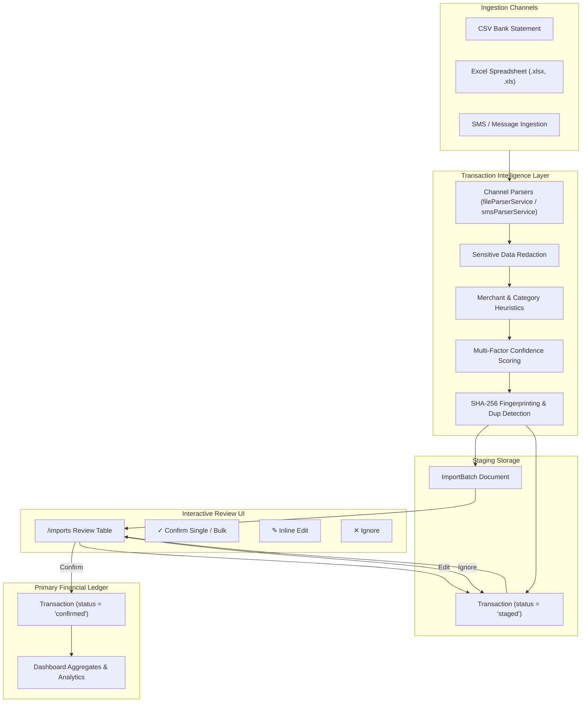

# FinTrack Ingestion & Staging Pipeline Architecture

## 1. Unified Staging Architecture
FinTrack enforces a **Staged Review Pattern** across all input channels. No external transaction file or message commits directly into the active financial ledger without user validation.

---

## 2. Ingestion Channels & Capabilities

| Channel | Input Formats | Features | Status |
| :--- | :--- | :--- | :--- |
| **Bank Statements** | `.csv`, `.xlsx`, `.xls` | Universal column aliasing (HDFC, ICICI, SBI, Axis, Kotak, generic formats), Indian date format normalizer (`DD/MM/YYYY`), currency cleaner | **Phase 1 Complete** |
| **SMS / Messages** | Pasted text, `.txt`, `.csv` | Amount detection, debit/credit detection, merchant extraction, OTP/PIN redaction, confidence scoring, demo dataset | **Phase 2 Complete** |

---

## 3. Review Operations API

- **Confirm Single**: `POST /api/imports/transactions/:id/confirm`
- **Inline Edit**: `PATCH /api/imports/transactions/:id`
- **Ignore**: `POST /api/imports/transactions/:id/ignore`
- **Confirm All Batch**: `POST /api/imports/:id/confirm-all`
- **Delete Batch**: `DELETE /api/imports/:id`
