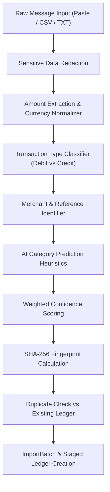

# FinTrack — Automatic Message / SMS Ingestion Architecture

## 1. Overview
The **FinTrack Message / SMS Ingestion System** enables automated extraction, categorization, entity recognition, and deduplication from financial transaction SMS alerts and text messages without requiring invasive device permissions.

All extracted messages flow through the unified **Staging & Review Pipeline**, ensuring user validation before transactions are committed to the primary financial ledger.

---

## 2. Supported Message Formats & Examples

The engine parses natural Indian and international banking SMS formats across major banks (HDFC, ICICI, SBI, Axis, Kotak, etc.) and payment platforms (UPI, IMPS, NEFT, Cards):

| Format Type | Synthetic Message Example | Extracted Details |
| :--- | :--- | :--- |
| **UPI Payment** | `"UPI payment of Rs.480 to SWIGGY on 26-09-2026 was successful. Ref: UPI48192019"` | Amount: ₹480, Merchant: `Swiggy`, Category: `Food`, Type: `expense`, Conf: 96% |
| **Card / Debit Alert** | `"INR 1,250 debited from your A/c 5491 for AMAZON on 25-09-2026. Txn ID: AMZ99210"` | Amount: ₹1250, Merchant: `Amazon`, Category: `Shopping`, Type: `expense`, Conf: 96% |
| **Salary Credit** | `"Rs 95,000.00 credited to your account. Salary credit from INFOSYS TECHNOLOGIES on 25-09-2026."` | Amount: ₹95000, Merchant: `Infosys`, Category: `Salary`, Type: `income`, Conf: 96% |
| **Cab / Transit** | `"Your UPI transaction of ₹650 to Uber was successful on 24-09-2026. Ref: UBR9921"` | Amount: ₹650, Merchant: `Uber`, Category: `Transport`, Type: `expense`, Conf: 90% |
| **IMPS Merchant** | `"Rs.2,400 debited via IMPS to ABC ELECTRONICS on 24-09-2026. UTR: IMPS881920"` | Amount: ₹2400, Merchant: `ABC Electronics`, Category: `Shopping`, Type: `expense`, Conf: 89% |
| **Utility Bill** | `"Electricity bill payment of Rs.1,850 to BESCOM completed successfully on 23-09-2026."` | Amount: ₹1850, Merchant: `BESCOM`, Category: `Bills`, Type: `expense`, Conf: 95% |
| **ATM Withdrawal** | `"ATM withdrawal of Rs.3,000 from ICICI ATM MG Road on 23-09-2026."` | Amount: ₹3000, Merchant: `ATM Cash Withdrawal`, Category: `Transfer`, Type: `expense`, Conf: 78% |
| **Investment** | `"Rs.15,000 debited from A/c 8812 for ZERODHA BROKING investment on 21-09-2026."` | Amount: ₹15000, Merchant: `Zerodha`, Category: `Investments`, Type: `expense`, Conf: 96% |
| **Refund / Cashback** | `"Refund of Rs.450 credited to your account from SWIGGY on 09-09-2026."` | Amount: ₹450, Merchant: `Swiggy`, Category: `Food`, Type: `income`, Conf: 92% |

---

## 3. Parser Pipeline Architecture

### Key Stages:
1. **Sensitive Data Redaction**:
   - Strips OTPs: `/\b(?:otp|one time password)\s*(?:is|:)?\s*(\d{4,8})\b/gi` -> `OTP: [REDACTED]`
   - Masks Account Numbers: `A/c 123456789012` -> `A/c XX9012`
   - Redacts PINs, CVVs, and passwords before database persistence.
2. **Amount Detection**:
   - Normalizes currency prefixes (`Rs.`, `INR`, `₹`), comma-separated numbers, and floating-point values.
3. **Type & Entity Extraction**:
   - Differentiates debits (`debited`, `spent`, `paid to`, `withdrawn`, `purchase`) from credits (`credited`, `deposited`, `salary credit`, `refund`).
4. **Weighted Confidence Scoring**:
   $$\text{Confidence} = (0.35 \times C_{\text{amount}}) + (0.25 \times C_{\text{type}}) + (0.20 \times C_{\text{merchant}}) + (0.15 \times C_{\text{category}}) + (0.05 \times C_{\text{date}})$$

---

## 4. Security & Privacy Guarantees

> [!IMPORTANT]
> **No Silent Device Reading**: For this major project MVP, FinTrack **NEVER** silently queries or intercepts Android/iOS phone SMS messages in the background. Ingestion occurs strictly via:
> 1. User-pasted message text
> 2. Uploaded SMS export files (`.csv` or `.txt`)
> 3. Bundled synthetic demonstration datasets

- **Data Minimization**: Non-financial notifications (OTP login codes, telecom data pack alerts) are rejected and not staged.
- **Redaction**: All banking credentials and verification codes are scrubbed prior to document creation.
- **Tenant Isolation**: Every `ImportBatch` and `Transaction` document is strictly bound to `req.userId` with compound unique indexing.

---

## 5. Future Android Integration Architecture

For production enterprise deployment, a dedicated companion Android app can be linked via authorized user consent:
1. **Android SMS Broadcast Receiver**: Listens only for sender IDs matching verified bank sender patterns (e.g. `AD-HDFCBK`, `VK-ICICIB`).
2. **Local Token Sanitizer**: Performs on-device regex sanitization to redact any OTP tokens before network dispatch.
3. **End-to-End Encrypted Sync**: Sends sanitized JSON payloads to `POST /api/imports/sms` over TLS with the user's JWT bearer token.
4. **Staging Queue**: Messages arrive in the user's `/imports` staging pipeline for single-click batch review.
