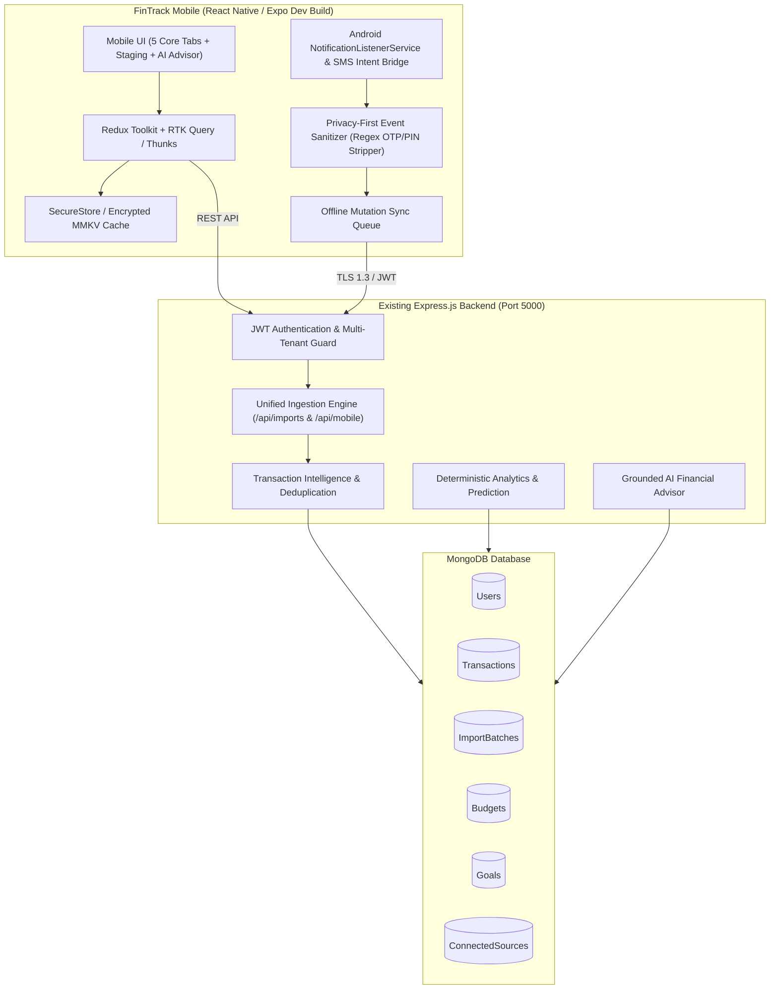
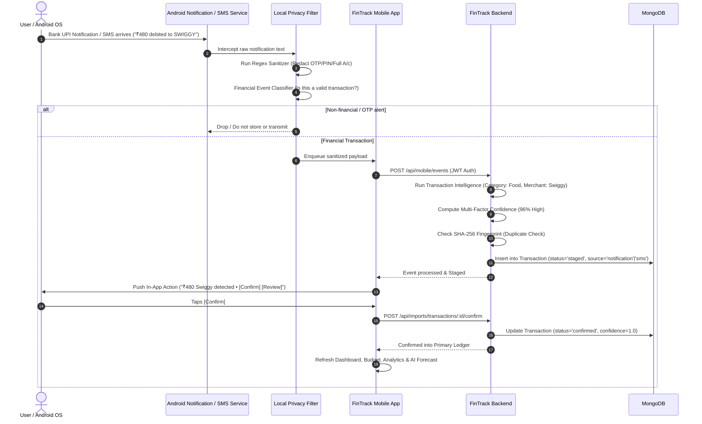
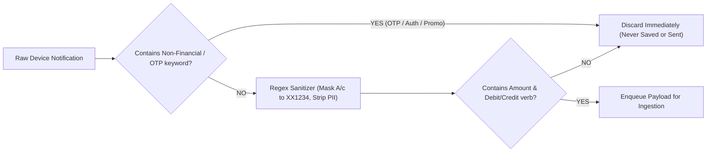

# FinTrack — Master Mobile-First Architecture & Engineering Specification

## 1. Executive Summary & Vision

**FinTrack** is an **AI-Powered Automatic Personal Finance Intelligence System** designed to eliminate manual expense entry. By combining automatic financial-event detection (Android Notification Listener, SMS alerts, Email OAuth, CSV/Excel/PDF/Receipt file uploads) with intelligent transaction processing, multi-factor confidence scoring, explainable financial analytics, deterministic forecasting, and a grounded AI Financial Advisor, FinTrack turns passive expense tracking into an active personal financial intelligence partner.

This document serves as the **master architectural blueprint** for extending the working FinTrack codebase into a **Mobile-First Android ecosystem (`mobile/`)** while preserving the existing web application (`client/`) as a desktop dashboard and leveraging the battle-tested backend (`server/`) and database (`MongoDB`).

---

## 2. Current Foundation & Baseline Audit

### 2.1 Backend Architecture (`server/`)
- **Runtime & Framework**: Node.js (ES Modules) with Express.js 4.18.2.
- **Security & Hardening**: `helmet` 8.1.0 security headers, `cors` with domain whitelisting, `express-rate-limit` (300 req / 15 min), and custom JWT verification middleware (`protect`).
- **Database Layer**: MongoDB 7.5.0 with Mongoose ODM, connection resilience, compound index optimization.
- **Ingestion & Processing Services**:
  - `fileParserService.js`: Dynamic bank statement column aliasing (HDFC, ICICI, SBI, Axis, Kotak, generic formats), Indian date format normalizer (`DD/MM/YYYY`), currency cleaner.
  - `smsParserService.js`: Regex sensitive-token redactor (OTPs, PINs, full card/account numbers), debit/credit keyword extractor, amount parser, reference extractor, multi-factor confidence scorer.
  - `transactionIntelligence.js`: 25+ Indian and global merchant/keyword heuristics, SHA-256 duplicate fingerprinting (`userId + date + amount + merchant + ref + type`).
  - `financeAnalyzer.js`: Deterministic financial summarizer (income, expense, savings, category breakdown, monthly trends, budget remaining, moving average forecasting).
  - `aiService.js`: OpenAI GPT-4o-mini integration with deterministic heuristic fallback when API keys are absent.
  - `reportController.js`: Streaming PDFKit binary report generator.

### 2.2 Web Client Architecture (`client/`)
- **Core**: React 18, Vite 5.4, Redux Toolkit, React Router DOM 6.
- **Styling**: Tailwind CSS with custom glassmorphism design system.
- **Visualization**: Recharts (LineChart, BarChart, PieChart).
- **Navigation & Pages**: Dashboard, Transactions, Imports & Staging (`/imports`), Budget, Insights, Reports, Profile, Login, Signup.
- **State Slices**: `authSlice`, `transactionSlice`, `budgetSlice`, `insightSlice`, `importSlice`.

### 2.3 Data Models
- **`User`**: `name`, `email`, `password` (bcrypt hashed, salt: 10), `createdAt`, `updatedAt`.
- **`Transaction`**: `userId`, `title`, `merchant`, `amount`, `type` (`income` | `expense` | `transfer`), `category`, `paymentMethod` (`cash` | `card` | `bank_transfer` | `upi` | `wallet` | `other`), `source` (`manual` | `csv` | `excel` | `pdf` | `receipt_ocr` | `email` | `sms`), `sourceReference`, `externalTransactionId`, `confidence`, `status` (`staged` | `confirmed` | `ignored`), `fingerprint`, `isDuplicate`, `isRecurring`, `recurringPattern`, `importBatchId`, `metadata`, `transactionDate`.
- **`Budget`**: `userId`, `monthlyBudget`, `categoryBudgets: [{ category, limit }]`.
- **`ImportBatch`**: `userId`, `source`, `fileName`, `fileSize`, `totalRecords`, `processedRecords`, `confirmedRecords`, `ignoredRecords`, `duplicateRecords`, `failedRecords`, `status` (`UPLOADED` | `PROCESSING` | `REVIEW_REQUIRED` | `COMPLETED` | `FAILED`), `summary`, `createdAt`, `completedAt`.

### 2.4 Existing Ingestion & Review Pipeline
All incoming transactions follow the **Staged Review Lifecycle**:
$$\text{Raw Event / File} \longrightarrow \text{Extraction} \longrightarrow \text{Categorization} \longrightarrow \text{Duplicate Detection} \longrightarrow \text{Staging} \longrightarrow \text{User Review} \longrightarrow \text{Ledger}$$
Unconfirmed staged records are strictly filtered out (`status: { $ne: 'staged' }`) from primary ledger calculations, budgets, dashboard metrics, AI insights, and PDF reports until explicitly confirmed.

---

## 3. Mobile Architecture Decision



### 3.1 Technology Stack Selection: React Native with Expo Development Build (Config Plugins & Native Modules)
- **Choice**: **React Native (0.74+) with Expo Development Client / Custom Native Modules**.
- **Rationale**:
  1. **Native Android Capabilities**: Android Notification Listener (`NotificationListenerService`) and Broadcast Receivers require native Android Kotlin/Java code and `AndroidManifest.xml` intent-filter registrations. Expo Dev Clients provide full native access with the stability and ecosystem benefits of Expo.
  2. **Code Sharing**: High reuse of Redux slice patterns, formatting utilities (`currency`, `formatDate`), validation logic, and synthetic datasets from the web client.
  3. **Security & Cryptography**: Native cryptographic key storage via `expo-secure-store` and fast local disk persistence via `react-native-mmkv` / `@react-native-async-storage/async-storage`.
  4. **Performant Visualization**: Native gesture handling (`react-native-gesture-handler`, `react-native-reanimated`) and charting (`react-native-svg` + `victory-native` / `react-native-chart-kit`).

### 3.2 Mobile Folder Structure (`mobile/`)
```
mobile/
├── android/                   # Native Android project files & manifests
├── assets/                    # App icons, splash screens, illustration assets
├── src/
│   ├── api/                   # Axios client with JWT interceptors & sync queue
│   ├── components/            # Reusable UI components (Cards, Badges, Modals, Buttons)
│   ├── data/                  # Synthetic datasets (32+ SMS alerts, demo transactions)
│   ├── navigation/            # React Navigation (BottomTabs, NativeStackNavigator)
│   ├── screens/
│   │   ├── auth/              # Login, Signup, Onboarding screens
│   │   ├── dashboard/         # Mobile Home, Financial Summary, KPI cards
│   │   ├── transactions/      # Ledger list, Search/Filters, Manual Add, Details
│   │   ├── review/            # Staging Review Queue (Confirm, Edit, Ignore)
│   │   ├── insights/          # AI Insights, Forecasts, Anomalies, Financial Health
│   │   ├── advisor/           # "Ask FinTrack" Grounded AI Chat Assistant
│   │   ├── goals/             # Goal tracking, Progress visualizers, What-If Simulator
│   │   ├── imports/           # Connected Sources, SMS Ingestion, File Pickers
│   │   ├── profile/           # Profile, Settings, Security, Data Wipe, Export
│   ├── services/
│   │   ├── androidService.js  # Android Notification / SMS bridge & permission manager
│   │   ├── localFilterService.js # Local regex redaction & non-financial event filter
│   │   ├── offlineStorage.js  # SecureStore & local cache manager
│   │   └── syncService.js     # Background synchronization & retry queue
│   ├── store/                 # Redux Toolkit store & slices
│   └── utils/                 # Currency formatters, date normalizers, confidence helpers
├── app.json
├── package.json
└── tsconfig.json
```

---

## 4. End-to-End Data Flow



---

## 5. API Strategy: Reuse vs. New Endpoints

### 5.1 Reused Existing APIs (100% Shared with Web)
| Existing Endpoint | HTTP Method | Mobile Consumer | Purpose |
| :--- | :---: | :--- | :--- |
| `/api/auth/signup` | `POST` | Auth Screen | User registration |
| `/api/auth/login` | `POST` | Auth Screen | User login & JWT issuance |
| `/api/auth/me` | `GET` | App Bootstrap | Refresh session & user profile |
| `/api/auth/profile` | `PUT` | Profile Screen | Update user preferences / currency |
| `/api/transactions` | `GET` | Transactions Tab | Query confirmed ledger with pagination/filters |
| `/api/transactions` | `POST` | Manual Add Modal | Manual fallback transaction creation |
| `/api/transactions/:id` | `GET` / `PUT` / `DELETE` | Transaction Details | View, edit, or delete confirmed transaction |
| `/api/dashboard/summary` | `GET` | Home Tab | Retrieve income, expense, savings, monthly trend, recent txns |
| `/api/budget` | `GET` / `POST` | Budget Card & Detail | Fetch / update monthly budget and category limits |
| `/api/ai/insights` | `GET` | Insights Tab | Generate / fetch AI financial recommendations |
| `/api/ai/predict` | `GET` | Forecast Card | Compute historical moving-average expense projection |
| `/api/reports/pdf` | `GET` | Profile / Export | Download monthly PDF financial statement |
| `/api/imports` | `GET` | Import History | List upload and ingestion batches |
| `/api/imports/csv` | `POST` | File Ingestion | Upload CSV statement |
| `/api/imports/excel` | `POST` | File Ingestion | Upload XLSX statement |
| `/api/imports/sms` | `POST` | SMS Ingestion | Ingest batch SMS text or files |
| `/api/imports/:id/transactions` | `GET` | Review Queue | Fetch pending staged transactions |
| `/api/imports/transactions/:id/confirm` | `POST` | Review Card | Confirm single staged transaction |
| `/api/imports/transactions/:id` | `PATCH` | Review Card (Edit) | Inline update staged transaction attributes |
| `/api/imports/transactions/:id/ignore` | `POST` | Review Card (Ignore) | Ignore staged transaction |
| `/api/imports/:id/confirm-all` | `POST` | Review Header | Bulk confirm all staged transactions in a batch |

### 5.2 Genuinely Required New Mobile & Intelligence Endpoints
To support the expanded major project requirements without bloating existing endpoints, we introduce the following clean, modular routers:

#### 1. Mobile Event Ingestion (`/api/mobile`)
- `POST /api/mobile/events`: Ingests single or batched Android notification events captured on-device. Runs redaction, categorization, deduplication, and staging.
- `GET /api/mobile/sources`: Returns connected sources status (Android Notifications, SMS, Email, File) and sync timestamps.
- `POST /api/mobile/sync`: Batch offline sync endpoint receiving queued offline mutations with idempotency keys.

#### 2. Financial Goals & What-If Simulation (`/api/goals`)
- `GET /api/goals`: List user financial goals with current savings, target amounts, progress %, and projected completion dates.
- `POST /api/goals`: Create new savings goal (`name`, `targetAmount`, `currentAmount`, `targetDate`, `category`).
- `PUT /api/goals/:id` & `DELETE /api/goals/:id`: Update or delete goal.
- `POST /api/goals/simulate-purchase`: **What-If Purchase Simulator & Affordability Engine**. Takes `{ purchaseAmount, category, description }` and evaluates impact against current monthly savings, budget limit, goal timelines, and recurring obligations.

#### 3. Deep Analytics & Health Engine (`/api/analytics`)
- `GET /api/analytics/financial-health`: Computes explainable **0–100 Financial Health Score** based on 5 transparent weighted pillars:
  1. *Savings Rate* (30%)
  2. *Budget Adherence* (25%)
  3. *Spending Volatility & Trend* (20%)
  4. *Emergency Runway / Net Cash Flow* (15%)
  5. *Recurring Expense Burden* (10%)
- `GET /api/analytics/recurring`: Identifies recurring payment patterns (subscriptions, utilities, rent, EMI) from transaction history.
- `GET /api/analytics/anomalies`: Detects unusual transactions (spending spikes > 2.5x category mean, unexpected merchants, rapid repeated charges).

#### 4. Grounded AI Financial Advisor (`/api/ai/advisor`)
- `POST /api/ai/advisor`: Interactive **"Ask FinTrack"** natural language financial assistant.
  - Takes user query: `"Why did my expenses increase?"` or `"Can I afford a ₹25,000 laptop?"`.
  - Performs intent detection, queries actual deterministic aggregates from MongoDB (totals, category breakdowns, anomalies, goal progress), builds a grounded structured context, and generates a factual, hallucination-free response.

#### 5. Email OAuth & Incremental Ingestion (`/api/email`)
- `GET /api/email/auth-url`: Generates secure Google OAuth 2.0 authorization URL with `gmail.readonly` scope.
- `POST /api/email/oauth-callback`: Exchanges OAuth authorization code for encrypted refresh token and creates `ConnectedSource` record.
- `POST /api/email/sync`: Triggers incremental sync fetching only unread financial alerts (`after:TIMESTAMP`), running them through the standard staging pipeline.
- `POST /api/email/disconnect`: Revokes tokens and removes email connection.

---

## 6. Database Schema Extensions

We extend the existing database models with **strict backwards compatibility** and add two dedicated models for Goals and Connected Sources.

### 6.1 New Model: `Goal` (`server/models/Goal.js`)
```javascript
const goalSchema = new mongoose.Schema({
  userId: { type: mongoose.Schema.Types.ObjectId, ref: 'User', required: true, index: true },
  title: { type: String, required: true, trim: true },
  targetAmount: { type: Number, required: true, min: 1 },
  currentAmount: { type: Number, default: 0, min: 0 },
  category: { type: String, default: 'General' },
  targetDate: { type: Date, required: true },
  color: { type: String, default: '#2563eb' },
  status: { type: String, enum: ['in_progress', 'achieved', 'paused'], default: 'in_progress' },
  createdAt: { type: Date, default: Date.now }
});
goalSchema.index({ userId: 1, targetDate: 1 });
```

### 6.2 New Model: `ConnectedSource` (`server/models/ConnectedSource.js`)
```javascript
const connectedSourceSchema = new mongoose.Schema({
  userId: { type: mongoose.Schema.Types.ObjectId, ref: 'User', required: true, index: true },
  sourceType: { type: String, enum: ['android_notification', 'sms', 'email_gmail', 'file_upload'], required: true },
  identifier: { type: String, default: '' }, // e.g. user@gmail.com or Device Model
  status: { type: String, enum: ['active', 'paused', 'revoked'], default: 'active' },
  authData: {
    accessToken: { type: String, select: false },
    refreshToken: { type: String, select: false },
    tokenExpiry: { type: Date }
  },
  lastSyncAt: { type: Date, default: null },
  lastSyncCursor: { type: String, default: null },
  metadata: { type: mongoose.Schema.Types.Mixed, default: {} },
  createdAt: { type: Date, default: Date.now }
});
connectedSourceSchema.index({ userId: 1, sourceType: 1 }, { unique: true });
```

### 6.3 Backwards-Compatible Field Additions to `Transaction`
- `source`: Extended enum to support `['manual', 'csv', 'excel', 'pdf', 'receipt_ocr', 'email', 'sms', 'notification']`.
- `anomalyFlags`: Array of strings (`['HIGH_SPEND_SPIKE', 'NEW_MERCHANT', 'RAPID_RECURRENCE']`).
- `metadata.rawEvent`: Non-sensitive extracted event parameters.

---

## 7. Android Device Integration & Privacy Guarantees

### 7.1 Android Architecture & Permissions
- **Notification Listener Service**:
  - Implements Android `NotificationListenerService` (`FinTrackNotificationListener.kt`).
  - Listens only for active notifications from verified banking and payment package names:
    - `com.google.android.apps.nbu.paisa.user` (Google Pay)
    - `net.one97.paytm` (Paytm)
    - `com.phonepe.app` (PhonePe)
    - `com.hdfcbank.android` (HDFC MobileBanking)
    - `com.icicibank.mobile` (iMobile)
    - `com.sbi.upi` / `com.sbi.lotusintouch` (SBI YONO / BHIM SBI)
    - `com.axis.mobile` (Axis Mobile)
    - `com.msf.kbank.mobile` (Kotak 811)
    - Generic SMS apps (`com.google.android.apps.messaging`, `com.samsung.android.messaging`).
- **Required Permission**: `android.permission.BIND_NOTIFICATION_LISTENER_SERVICE`.
  - User is guided to Android Settings via `Settings.ACTION_NOTIFICATION_LISTENER_DETAIL_SETTINGS` with full plain-English transparency.

### 7.2 Privacy-First On-Device Sanitization Layer


- **Zero Plaintext OTP Transmission**: If a notification includes an OTP, the regex redactor strips it before network transmission.
- **No Background Monitoring of Unrelated Apps**: Notifications from WhatsApp, Instagram, YouTube, Gmail personal chats, etc. are immediately ignored at the OS event level.

---

## 8. Email OAuth & Incremental Synchronization

### 8.1 Google OAuth 2.0 Flow
1. **Consent Screen**: User clicks "Connect Gmail" in Connected Sources. The app displays clear scope explanation (`https://www.googleapis.com/auth/gmail.readonly`).
2. **Token Exchange**: Server receives authorization code, exchanges it with Google OAuth servers for an access token and refresh token, and stores tokens securely.
3. **Incremental Sync**:
   - Query format: `from:(alerts@hdfcbank.net OR alert@icicibank.com OR alerts@axisbank.com OR donotreply@sbi.co.in) after:{lastSyncTimestamp}`.
   - Only processes newly received messages since the last successful sync timestamp.
   - Extracts subject and snippet, runs through `smsParserService` & `transactionIntelligence`, and creates staged transactions linked to an `ImportBatch` (`source: 'email'`).

---

## 9. Security, Privacy & Multi-Tenant Isolation

1. **Authentication & Token Storage**:
   - Mobile client stores JWT in native **SecureStore** (iOS Keychain / Android EncryptedSharedPreferences).
   - Axios request interceptor injects `Authorization: Bearer <token>`.
   - 401 response interceptor automatically invalidates expired sessions and redirects to Login.
2. **Server-Side Authorization**:
   - Every single protected endpoint strictly enforces `userId: req.userId` from the verified JWT.
   - Cross-user access is impossible and rejected with `404 Not Found` or `401 Unauthorized`.
3. **Redaction & Logging Rules**:
   - Production logs NEVER print raw notification strings, email message bodies, or passwords.
   - Account numbers are stored masked as `A/c XX1234`.
4. **User Controls**:
   - Users can disconnect any connected source at any time with a single tap.
   - Profile settings offer complete **"Clear Financial Data"** and **"Delete Account"** options.

---

## 10. Offline Caching & Synchronization Strategy

- **Local Storage Layer**: Redux state persisted to `MMKV` / `AsyncStorage` for instant offline rendering of:
  - Dashboard KPIs & monthly trend charts
  - Confirmed transaction history
  - Budget status and category limits
  - Goals and Financial Health scores
- **Offline Mutation Queue**:
  - When offline, manual adds, edits, or confirm actions are assigned an idempotent UUID (`mutationId`) and appended to a local pending sync queue.
  - When network connectivity is restored (`NetInfo` listener), `syncService` transmits the pending mutation batch to `POST /api/mobile/sync`.
  - Backend checks mutation UUIDs to guarantee zero duplicate creations during retries.

---

## 11. Testing & QA Strategy

```
=======================================================================
                      FINTRACK TEST PYRAMID
=======================================================================
[E2E / Live Verification]   Live Server + MongoDB E2E Suite (verify_phaseX_e2e.js)
                           Browser / Mobile UI Interactive Flow Tests
-----------------------------------------------------------------------
[Integration Tests]        API Auth Isolation, Staged Workflow, Multi-Batch Sync
                           Supertest Endpoint Suites (auth, import, mobile, goals)
-----------------------------------------------------------------------
[Unit Tests]               Parser Normalization, Intelligence Heuristics,
                           Confidence Math, SHA-256 Fingerprints, Redux Reducers
=======================================================================
```

- **Backend Jest Suites**:
  - `auth_api.test.js`: Auth & security headers.
  - `import_csv_excel.test.js`: Phase 1 Bank statements ingestion.
  - `sms_ingestion.test.js`: Phase 2 SMS parsing & sensitive redaction.
  - `mobile_events.test.js`: Phase 5 Notification ingestion & event parsing.
  - `goals_analytics.test.js`: Phase 7 Goals, What-If simulator, Financial Health.
  - `ai_advisor.test.js`: Phase 8 Grounded AI Advisor intent & context.
- **Frontend Vitest & Mobile Jest Suites**:
  - Store initialization, formatters, synthetic dataset validation, offline queue reducers.

---

## 12. Synthetic Demo Mode & College Major Project Presentation

To enable flawless college project demonstrations without requiring live bank connections or real credit card alerts:
- **Preloaded Synthetic Data Engine**:
  - Includes 32+ realistic Indian bank messages (Swiggy, Amazon, Infosys Salary, Uber, BESCOM, Netflix, Zerodha, ATM withdrawals).
- **Interactive In-App Event Simulator**:
  - The mobile app includes a **"Simulate Live Bank Event"** trigger button in developer/demo mode.
  - Tapping it triggers an on-device notification banner `"₹480 debited via UPI to SWIGGY"`, simulates the listener, passes it through the AI intelligence engine, stages the transaction, prompts the user with `[Confirm] / [Review]`, and instantly recalculates the entire dashboard, budget, forecast, and AI assistant context live!

---

## 13. Detailed 12-Phase Development Roadmap

| Phase | Title | Scope & Deliverables | Verification Gates |
| :---: | :--- | :--- | :--- |
| **Phase 0** | **System Audit & Architecture Blueprint** | Full codebase audit, architectural design, database design, creating `MOBILE_ARCHITECTURE.md`. *(Current Phase)* | Approved before coding |
| **Phase 1** | **Mobile Foundation & Auth** | Initialize `mobile/` React Native foundation, theme, navigation (5 tabs + stacks), secure JWT store, auth screens (Login, Signup, Onboarding), connect with backend. | Mobile tests pass, Web untouched |
| **Phase 2** | **Mobile Dashboard & Summary** | Mobile Home screen, Financial KPI cards (Income, Expense, Net Savings), Spending trend charts, budget progress widget, AI alert banners. | Verified against live backend |
| **Phase 3** | **Mobile Transactions & Ledger** | Transaction list with infinite scroll, category & type filters, search bar, transaction detail modal, manual add transaction form. | CRUD verified & isolated |
| **Phase 4** | **Mobile Imports & Staged Review** | Connect mobile app to Phase 1 (CSV/Excel) and Phase 2 (SMS) import endpoints, Staging review cards (`[Confirm]`, `[Edit]`, `[Ignore]`, `[Confirm All]`). | Staging workflow verified |
| **Phase 5** | **Android Automatic Event Detection** | Implement Android `NotificationListenerService`, local privacy filter, permission management screen, notification trigger simulation for demo. | Event lifecycle verified |
| **Phase 6** | **Email Integration (Gmail OAuth)** | Implement `/api/email` OAuth endpoints, token encryption, incremental query synchronization (`from:bank after:date`), staged email review. | OAuth & incremental sync tested |
| **Phase 7** | **Financial Intelligence & What-If Simulator** | Implement Financial Goals CRUD, What-If Purchase Simulator (`/api/goals/simulate-purchase`), 0–100 Financial Health score, Recurring transaction detector, Anomaly detector. | Deterministic formulas verified |
| **Phase 8** | **Grounded AI Finance Advisor** | Implement **"Ask FinTrack"** conversational assistant with structured financial context injection, factual grounding guardrails, prompt engineering. | Hallucination-free verification |
| **Phase 9** | **Offline Caching & Background Sync** | Implement local MMKV/AsyncStorage caching, offline mutation queue with UUID idempotency, network reconnection listener. | Offline-to-online sync verified |
| **Phase 10**| **Comprehensive Security Audit** | Token encryption audit, sensitive data redaction audit, user data isolation verification, rate limit & security header tests. | 0 security flaws |
| **Phase 11**| **Full Test Suite & Production Build** | Run all backend test suites, frontend test suites, mobile test suites, production bundling, live E2E regression script. | 100% test pass rate |
| **Phase 12**| **Documentation & Demo Walkthrough** | Update `README.md`, `API.md`, `SECURITY.md`, `DEMO_GUIDE.md`, finalize university presentation guide. | Final delivery |

---

## 14. Key Technical Risks & Mitigations

1. **Android OS Background Battery Optimization & Permission Revocation**:
   - *Risk*: Android OEM battery savers (MIUI, Samsung OneUI) might terminate background notification listeners.
   - *Mitigation*: The app includes an explicit "Battery Optimization Whitelist" guide and provides immediate on-demand manual sync & fallback SMS paste/upload.
2. **Email OAuth Refresh Token Expiration**:
   - *Risk*: OAuth tokens expire or user changes password.
   - *Mitigation*: Server detects `400/401 invalid_grant` responses from Google, marks `ConnectedSource` status as `revoked`, and prompts the user to reconnect without failing application workflows.
3. **Cross-Source Duplicate Ingestion**:
   - *Risk*: Same transaction arrives via Notification, SMS, and monthly CSV bank statement.
   - *Mitigation*: SHA-256 deterministic fingerprinting (`userId + date + amount + merchant + ref + type`) flags matching records as `isDuplicate: true`, surfacing them with an amber warning badge for one-click confirmation or ignore.
4. **AI Hallucinations in Financial Advice**:
   - *Risk*: Large language models generating incorrect spending totals or balances.
   - *Mitigation*: **Strict Deterministic Grounding**. Totals, category percentages, budget balances, and what-if calculations are computed by Node.js deterministic math and supplied as immutable context to the LLM.

---

**Phase 0 Architecture is complete.** Awaiting your review and approval of `MOBILE_ARCHITECTURE.md` before starting Phase 1 (Mobile Foundation & Auth).
