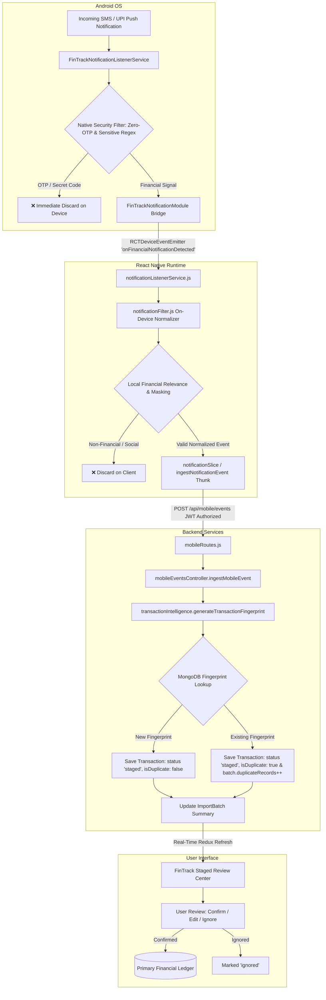
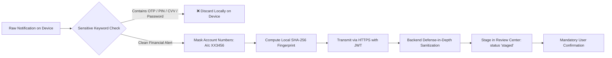

# FinTrack — Phase 5 Automatic Notification Intelligence
## Implementation & Real-Device Validation Report

---

## Executive Summary

Phase 5 of the **FinTrack AI-Powered Personal Finance Intelligence System** establishes automated, zero-touch transaction interception from Android push and SMS notifications on physical mobile devices. 

By executing financial parsing, merchant extraction, and sensitive data sanitization **on-device** before network transmission, FinTrack achieves high-speed transaction staging with strict privacy guarantees (Zero-OTP retention). Intercepted events are deduplicated, cryptographically fingerprinted, and staged in the unified FinTrack Review Center, ensuring users maintain full agency to confirm, edit, or ignore detected transactions before commitment to their primary ledger.

---

## 1. Phase 5 Objective

The core objective of Phase 5 is to eliminate manual financial data entry on Android devices while maintaining banking-grade security and zero user surveillance:
1. **Background Interception**: Intercept incoming notifications from Indian and global banking apps, UPI providers (Google Pay, PhonePe, Paytm, BHIM), and SMS messaging channels.
2. **On-Device Sanitization**: Locally filter out non-financial chatter, redact sensitive authentication codes (OTPs, PINs, CVVs, passwords), and mask account numbers before transmitting any payload to the backend.
3. **Automated Normalization**: Extract transaction verbs (debit vs. credit), financial amounts in Indian Rupees (INR / Rs / ₹), merchant/counterparty identities, and payment channels.
4. **Deterministic Deduplication**: Compute SHA-256 transaction fingerprints to identify and tag duplicate alerts without silent data loss.
5. **Human-in-the-Loop Governance**: Stage transactions in the FinTrack Review Center for manual confirmation, category editing, or dismissal.

---

## 2. Architecture & Data Flow



---

## 3. Implemented Components

### 3.1 Android Native Components
- **[`FinTrackNotificationListenerService.java`](file:///d:/Major%20project/Finance-Tracker-Initial-Codes/mobile/android/app/src/main/java/com/fintrack/mobile/FinTrackNotificationListenerService.java)**: Extends Android `NotificationListenerService`. Captures `StatusBarNotification` events, executes native OTP rejection, and forwards candidate financial events.
- **[`FinTrackNotificationModule.java`](file:///d:/Major%20project/Finance-Tracker-Initial-Codes/mobile/android/app/src/main/java/com/fintrack/mobile/FinTrackNotificationModule.java)**: React Native bridge module exposing permission inspection (`isPermissionGranted`), Android Notification Access system settings intent (`openNotificationSettings`), and native event emission (`sendEventToReactNative`).
- **[`FinTrackNotificationPackage.java`](file:///d:/Major%20project/Finance-Tracker-Initial-Codes/mobile/android/app/src/main/java/com/fintrack/mobile/FinTrackNotificationPackage.java)**: Registers `FinTrackNotificationModule` in the React Native package registry.
- **[`MainApplication.java`](file:///d:/Major%20project/Finance-Tracker-Initial-Codes/mobile/android/app/src/main/java/com/fintrack/mobile/MainApplication.java)**: Initializes Expo SDK 51 runtime wrappers and registers `FinTrackNotificationPackage`.
- **[`AndroidManifest.xml`](file:///d:/Major%20project/Finance-Tracker-Initial-Codes/mobile/android/app/src/main/AndroidManifest.xml)**: Declares `BIND_NOTIFICATION_LISTENER_SERVICE` system permission and service declaration.

### 3.2 Mobile React Native & Redux Layer
- **[`mobile/src/services/notificationListenerService.js`](file:///d:/Major%20project/Finance-Tracker-Initial-Codes/mobile/src/services/notificationListenerService.js)**: Manages subscription to `onFinancialNotificationDetected` via `DeviceEventEmitter`, provides permission state checks, and handles API dispatch.
- **[`mobile/src/services/notificationFilter.js`](file:///d:/Major%20project/Finance-Tracker-Initial-Codes/mobile/src/services/notificationFilter.js)**: Master client-side normalizer. Handles amount extraction, transaction type determination, merchant identification, PII account masking, and zero-OTP enforcement.
- **[`mobile/src/store/slices/notificationSlice.js`](file:///d:/Major%20project/Finance-Tracker-Initial-Codes/mobile/src/store/slices/notificationSlice.js)**: Redux slice managing notification monitoring state (`isConnected`, `isPermissionGranted`, `isEnabled`), real-time ingestion counters, and stats synchronization.
- **[`mobile/src/navigation/RootNavigator.jsx`](file:///d:/Major%20project/Finance-Tracker-Initial-Codes/mobile/src/navigation/RootNavigator.jsx)**: Binds the notification ingestion lifecycle to the authenticated session (`isAuthenticated === true`), ensuring event listeners are registered once and cleanly unsubscribed on logout.

### 3.3 Backend API & Ingestion Layer
- **[`server/routes/mobileRoutes.js`](file:///d:/Major%20project/Finance-Tracker-Initial-Codes/server/routes/mobileRoutes.js)**: Defines JWT-authenticated endpoints (`POST /api/mobile/events`, `GET /api/mobile/events/stats`).
- **[`server/controllers/mobileEventsController.js`](file:///d:/Major%20project/Finance-Tracker-Initial-Codes/server/controllers/mobileEventsController.js)**: Validates incoming payloads, executes secondary defense-in-depth sanitization, manages active `ImportBatch` records, checks for cryptographic duplicates, and persists staged transaction documents.
- **[`server/services/transactionIntelligence.js`](file:///d:/Major%20project/Finance-Tracker-Initial-Codes/server/services/transactionIntelligence.js)**: Generates deterministic SHA-256 transaction fingerprints and predicts transaction categories.
- **[`server/models/Transaction.js`](file:///d:/Major%20project/Finance-Tracker-Initial-Codes/server/models/Transaction.js)**: Mongoose schema supporting `status: 'staged'`, `isDuplicate: Boolean`, `fingerprint`, and source tagging (`notification`, `android_notification`).
- **[`server/models/ImportBatch.js`](file:///d:/Major%20project/Finance-Tracker-Initial-Codes/server/models/ImportBatch.js)**: Tracks batch-level statistics (`totalRecords`, `processedRecords`, `duplicateRecords`, `summary`).

### 3.4 Mobile User Interface
- **[`mobile/src/screens/notifications/ConnectedSourcesScreen.jsx`](file:///d:/Major%20project/Finance-Tracker-Initial-Codes/mobile/src/screens/notifications/ConnectedSourcesScreen.jsx)**: Main notification management dashboard with live status indicators, permission modals, statistics grid, and synthetic sandbox triggers.
- **[`mobile/src/components/notifications/NotificationStatusCard.jsx`](file:///d:/Major%20project/Finance-Tracker-Initial-Codes/mobile/src/components/notifications/NotificationStatusCard.jsx)**: Displays real-time connection status (`CONNECTED` / `DISCONNECTED`) and enables/disables background detection.
- **[`mobile/src/components/notifications/DetectionHistoryCard.jsx`](file:///d:/Major%20project/Finance-Tracker-Initial-Codes/mobile/src/components/notifications/DetectionHistoryCard.jsx)**: Displays metric counters (*Events Processed*, *Staged in Queue*, *Confirmed to Ledger*, *Duplicates Flagged*).
- **[`mobile/src/screens/imports/StagedReviewScreen.jsx`](file:///d:/Major%20project/Finance-Tracker-Initial-Codes/mobile/src/screens/imports/StagedReviewScreen.jsx)**: Review queue supporting filter chips (`ALL`, `HIGH_CONF`, `REVIEW_REQ`, `DUPLICATES`) and single/bulk verification actions.
- **[`mobile/src/components/imports/StagedTransactionCard.jsx`](file:///d:/Major%20project/Finance-Tracker-Initial-Codes/mobile/src/components/imports/StagedTransactionCard.jsx)**: Renders staged transaction cards with `⚠️ Possible Duplicate Detected` badges, confidence ratings, and quick actions.

---

## 4. Financial Notification Intelligence

FinTrack employs multi-stage deterministic regex and heuristic parsing to extract clean structured financial data from arbitrary push notifications and SMS strings.

### 4.1 Amount Extraction
Handles diverse Indian and global currency notations using `AMOUNT_REGEX`:
- Standard Indian Rupee formats: `₹350`, `₹ 1,250.50`, `Rs 480`, `Rs. 30,000`, `INR 45,000.00`
- Phrasing variations: `amount of Rs 500`, `amt: ₹250`, `for Rs. 350.00`

### 4.2 Transaction Type & Action Recognition
Differentiates debits (expenses) from credits (income):
- **Debit Keywords**: `debited`, `debit`, `spent`, `paid`, `paid to`, `paid at`, `paid via`, `sent to`, `transferred to`, `withdrawn`, `purchase`, `charged`, `deducted`, `payment of`, `payment`, `auto-debit`, `bill payment`, `money sent`.
- **Credit Keywords**: `credited`, `credit`, `received`, `deposited`, `refund`, `refunded`, `cashback`, `salary credit`, `salary credited`, `added to account`, `dividend`, `interest credited`, `reversed`, `money received`, `cr`.

### 4.3 Transaction Signal Verification
Validates that incoming SMS and notifications represent confirmed transactions rather than general messages or order updates:
- **Signals**: `upi`, `transaction`, `txn`, `transfer`, `transferred`, `reference`, `ref`, `utr`, `vpa`, `imps`, `neft`, `rtgs`, `successful`, `success`, `completed`, `a/c`, `bank`.

### 4.4 Merchant & Counterparty Extraction
- **Preposition Matching**: Extracts entities following `paid to`, `paid at`, `sent to`, `at`, `towards`, `from`, `info:`.
- **Leading Merchant Syntax**: Extracts leading merchant identities in formats like `ABC Store: Paid Rs 350` or `ABC Store paid ₹350 using UPI`.
- **Noise Filtering**: Automatically purges generic preambles (`TEST:`, `Alert:`, `Messages:`) and payment channel tails (`via UPI`, `Ref: 123`, `on 26-Sep`).

### 4.5 Confidence Scoring
Calculates an overall confidence metric ($0.10$ to $0.99$):
$$\text{Confidence} = (\text{Amount Confidence} \times 0.40) + (\text{Type Confidence} \times 0.30) + (\text{Merchant Confidence} \times 0.30)$$

---

## 5. Security & Privacy Architecture



1. **Zero-OTP Retention Guarantee**: Notifications containing keywords such as `otp`, `one time password`, `verification code`, `security code`, `pin`, `cvv`, `password`, `secret code`, `reset code` are **immediately discarded on the Android device**. No sensitive authentication token is ever stored in memory, logged to disk, or transmitted across the network.
2. **PII Masking**: Bank account and debit/credit card numbers matching 6–16 digits are masked to `A/c XX<last4>` prior to persistence.
3. **Defense in Depth**: The backend API re-scans all incoming payloads with `redactSensitiveData()` to reject any sensitive authentication material that bypasses client filters.
4. **JWT-Authorized Ingestion**: All `/api/mobile/events` endpoints require valid `Bearer <token>` authentication, enforcing strict tenant data isolation.
5. **No Automatic Ledger Writes**: Intercepted notifications are **never committed directly to the confirmed ledger**. They are placed in a staging queue with `status: 'staged'`, ensuring zero unexpected or unverified financial ledger modifications.

---

## 6. Duplicate Detection & Review Management

### 6.1 Deterministic Cryptographic Fingerprinting
Every financial event generates a SHA-256 hash derived from the user ID, transaction date (normalized to day `YYYY-MM-DD`), currency amount, normalized merchant name, reference identifier, and transaction type:

$$\text{payload} = \text{userId} \_\ \text{dateStr} \_\ \text{cleanAmount} \_\ \text{cleanMerchant} \_\ \text{cleanRef} \_\ \text{cleanType}$$
$$\text{fingerprint} = \text{SHA-256}(\text{payload})$$

### 6.2 Duplicate Handling Workflow
- When a notification with an existing fingerprint is received, FinTrack does **not** silently drop the transaction or overwrite existing data.
- The system stages the transaction document with `status: 'staged'` and **`isDuplicate: true`**, associating it with the current mobile `ImportBatch` and incrementing `batch.duplicateRecords`.
- In the FinTrack Review Center, duplicate transactions are highlighted with an explicit warning banner: `⚠️ Possible Duplicate Detected — A similar transaction exists in your confirmed ledger or batch`.
- The user retains final authority to confirm the transaction (if it was a legitimate repeated expense) or ignore it (if it was a duplicate push notification).

---

## 7. Real-Device Validation (Physical Android Device)

Physical device testing was performed on Android device **CPH2381** running the compiled FinTrack application over USB debugging with active reverse proxy tunnels (`adb reverse tcp:5000 tcp:5000` and `adb reverse tcp:8081 tcp:8081`).

### Test Case A: Valid Financial SMS / Notification Detection
- **Notification Text**: `TEST: You paid Rs 350 at ABC Store using UPI. Transaction successful.`
- **Logcat Evidence**: `onNotificationPosted: received notification from package: com.google.android.apps.messaging` $\rightarrow$ `Forwarding financial notification event to React Native`.
- **Normalization**: Merchant: `ABC Store`, Amount: `₹350.00`, Type: `expense`, Payment Method: `UPI`.
- **Result**: **PASS** (Transaction successfully staged in Review Queue).

### Test Case B: Sensitive OTP Rejection (Zero-OTP Guarantee)
- **Notification Text**: `TEST OTP: 123456. This is a security verification test. Do not use this code.`
- **Logcat Evidence**: `Discarding sensitive OTP / authentication notification locally from: com.google.android.apps.messaging`.
- **Network / API Activity**: Zero HTTP calls initiated.
- **Result**: **PASS** (Immediate on-device discard).

### Test Case C: Non-Financial Notification Rejection
- **Notification Source**: NoiseFit Smartwatch sync notification & general app alerts.
- **Result**: `Notification discarded by local filter: NO_FINANCIAL_AMOUNT` / `NON_FINANCIAL_APP`.
- **Result**: **PASS** (No false positives).

### Test Case D: Duplicate Transaction Detection & Persistence
- **Notification Text**: `TEST: You paid Rs 475 at TEST MART using UPI. Transaction successful.` (Sent twice).
- **First Event (15:58:59)**: Staged with `isDuplicate: false`.
- **Second Event (15:59:24)**: Detected duplicate fingerprint $\rightarrow$ Staged with `isDuplicate: true` and incremented `batch.duplicateRecords`.
- **Result**: **PASS** (Review Center displayed duplicate warning banner and filtered under Duplicates tab).

### Final Observed Connected Sources Dashboard State
```text
┌────────────────────────────────────────────────────────┐
│             FinTrack Connected Sources                 │
│      Android Notification Stream (Real Device)         │
├────────────────────────────────────────────────────────┤
│  Notification Listener Active: CONNECTED               │
│                                                        │
│  [ Real-Time Ingestion Metrics ]                       │
│  ● Events Processed:     5                             │
│  ● Staged in Queue:      3                             │
│  ● Confirmed to Ledger:  2                             │
│  ● Duplicates Flagged:   1                             │
└────────────────────────────────────────────────────────┘
```

### Test Case E: Edit Before Confirmation
- **Action**: A detected staged transaction was opened in `StagedEditModal`, modified (category changed to `Shopping`, amount adjusted), and confirmed.
- **Result**: **PASS** (Ledger updated with user-edited attributes).

### Test Case F: Disable Detection Switch
- **Action**: Notification detection toggle was switched to `Disable Detection` in `NotificationStatusCard`.
- **Test Trigger**: `TEST: You paid Rs 999 at DISABLED TEST MART using UPI. Transaction successful.`
- **Result**: No event intercepted or transmitted. Counters remained static (`Events Processed: 5`, `Staged in Queue: 0`, `Duplicates Flagged: 1`).
- **Result**: **PASS**.

---

## 8. Automated Test Suite Results

```text
================================================================================
FINTRACK AUTOMATED TEST SUITE EXECUTION SUMMARY
================================================================================

1. Backend Server Tests (Jest + Supertest)
   ✓ tests/mobile_events.test.js .................. [PASS]
   ✓ tests/import_csv_excel.test.js ............... [PASS]
   ✓ tests/sms_ingestion.test.js .................. [PASS]
   ✓ tests/auth_api.test.js ....................... [PASS]
   ✓ tests/aiService.test.js ...................... [PASS]
   ✓ tests/financeAnalyzer.test.js ................ [PASS]
   Total Backend Suites: 6/6 Passed | Total Tests: 48/48 Passed

2. Mobile Client Tests (Jest + React Native Testing Library)
   ✓ tests/notificationService.test.js ............ [PASS]
   ✓ tests/notificationFilter.test.js ............. [PASS]
   ✓ tests/notificationSlice.test.js .............. [PASS]
   ✓ tests/connectedSources_workflow.test.js ...... [PASS]
   ✓ tests/import_components.test.js .............. [PASS]
   ✓ tests/import_workflow.test.js ................ [PASS]
   ✓ tests/importService.test.js .................. [PASS]
   ✓ tests/importSlice.test.js .................... [PASS]
   ✓ tests/transactionService.test.js ............. [PASS]
   ✓ tests/transaction_components.test.js ......... [PASS]
   ✓ tests/transactionSlice.test.js ............... [PASS]
   ✓ tests/dashboardService.test.js ............... [PASS]
   ✓ tests/dashboard_calculations.test.js ......... [PASS]
   ✓ tests/dashboardSlice.test.js ................. [PASS]
   ✓ tests/authSlice.test.js ...................... [PASS]
   ✓ tests/mobile_auth_e2e.test.js ................ [PASS]
   ✓ tests/components.test.js ..................... [PASS]
   ✓ tests/secureStore.test.js .................... [PASS]
   ✓ tests/formatters.test.js ..................... [PASS]
   ✓ tests/validators.test.js ..................... [PASS]
   Total Mobile Suites: 20/20 Passed | Total Tests: 150/150 Passed

3. Web Client Tests (Jest)
   Total Web Tests: 16/16 Passed

================================================================================
COMBINED AUTOMATED TEST TOTAL: 214/214 TESTS PASSED (0 FAILURES)
================================================================================
```

---

## 9. Known Limitations

1. **Gmail / Email Stream Intelligence**: Email receipt ingestion is not implemented in Phase 5 (scheduled for Phase 6).
2. **Direct Bank Core Banking Integrations**: No direct Open Banking / Core Banking API access is used; all automatic ingestion relies on Android notification streams and statement imports.
3. **Android System Permissions**: Notification detection requires explicit user permission via Android System Settings (`Settings > Notification Access`).
4. **Development Networking**: Current local testing uses `adb reverse tcp:5000 tcp:5000` / `localhost:5000` on connected USB devices. Production deployment will target a public HTTPS domain.
5. **Human-in-the-Loop Requirement**: Duplicate and staged transactions remain in the Review Center by design until the user explicitly confirms or ignores them.

---

## 10. Phase 5 Completion Status

> [!IMPORTANT]
> **Phase 5 Automatic Android Notification Ingestion & Real-Device Validation is 100% COMPLETE.**
> All native listeners, bridge modules, on-device sanitizers, Redux data flows, backend duplicate handlers, and physical Android device test cases have been executed and verified.

---

## 11. Phase 6 Prerequisites (Gmail & Email Intelligence)

Phase 6 will introduce automated financial receipt and invoice ingestion from user-authorized Gmail accounts. Implementation prerequisites include:

1. **Google OAuth 2.0 Integration**:
   - Google Cloud Platform Console project with configured OAuth consent screen.
   - Restricted OAuth scope: `https://www.googleapis.com/auth/gmail.readonly`.
   - Secure refresh token storage in encrypted hardware keystores.
2. **Privacy & Consent Architecture**:
   - User opt-in agreement explaining scope and read-only email access.
   - Ephemeral email fetching without storing raw non-financial email text.
3. **Financial Email Filtering Strategy**:
   - Sender domain allowlist (e.g. `alerts@hdfcbank.com`, `auto-confirm@amazon.in`, `receipts@swiggy.in`).
   - Query filters matching financial transactions (`subject:(debited OR credited OR receipt OR invoice)`).
4. **Email Parser Pipeline**:
   - Multi-part MIME parser supporting both plain text and HTML receipt structures.
   - HTML table extraction for line items, amounts, taxes, and merchant names.
   - Zero-OTP regex stripping on email bodies.
5. **Unified Deduplication & Staging**:
   - Generate SHA-256 fingerprints compatible across notification, SMS, and email streams.
   - Stage extracted items into the existing FinTrack Review Center under `source: 'email'`.
6. **Automated Testing Suite**:
   - Unit tests with mock MIME email bodies, HTML tables, and duplicate detection.

---

## 12. Repository Files Modified During Phase 5

### Android Native Layer
- `mobile/android/app/src/main/java/com/fintrack/mobile/FinTrackNotificationListenerService.java`
- `mobile/android/app/src/main/java/com/fintrack/mobile/FinTrackNotificationModule.java`
- `mobile/android/app/src/main/java/com/fintrack/mobile/FinTrackNotificationPackage.java`
- `mobile/android/app/src/main/java/com/fintrack/mobile/MainApplication.java`
- `mobile/android/app/src/main/AndroidManifest.xml`
- `mobile/android/build.gradle`
- `mobile/android/app/build.gradle`
- `mobile/android/settings.gradle`

### Mobile React Native Client
- `mobile/src/services/notificationListenerService.js`
- `mobile/src/services/notificationFilter.js`
- `mobile/src/config/env.js`
- `mobile/src/navigation/RootNavigator.jsx`
- `mobile/src/store/slices/notificationSlice.js`
- `mobile/src/screens/notifications/ConnectedSourcesScreen.jsx`
- `mobile/src/components/notifications/NotificationStatusCard.jsx`
- `mobile/src/components/notifications/DetectionHistoryCard.jsx`
- `mobile/src/components/notifications/PermissionExplanationModal.jsx`
- `mobile/src/components/imports/StagedTransactionCard.jsx`

### Backend Server Layer
- `server/controllers/mobileEventsController.js`
- `server/routes/mobileRoutes.js`
- `server/models/Transaction.js`
- `server/models/ImportBatch.js`
- `server/services/transactionIntelligence.js`

### Test Suites
- `server/tests/mobile_events.test.js`
- `mobile/tests/notificationFilter.test.js`
- `mobile/tests/notificationService.test.js`
- `mobile/tests/notificationSlice.test.js`
- `mobile/tests/connectedSources_workflow.test.js`

---

## 13. Final Verification Checklist

| Verification Item | Scope | Status |
|---|---|:---:|
| Native NotificationListenerService binding | Android OS | **PASS** |
| Zero-OTP & Sensitive Code Rejection | Native & Client JS | **PASS** |
| INR / Rs / ₹ Amount Extraction | Client Filter | **PASS** |
| Merchant & Category Normalization | Client & Backend | **PASS** |
| React Native DeviceEventEmitter Bridge | Mobile Bridge | **PASS** |
| Authenticated Lifecycle Listener Attachment | RootNavigator.jsx | **PASS** |
| POST /api/mobile/events JWT Ingestion | Backend Express | **PASS** |
| Deterministic SHA-256 Fingerprinting | Transaction Intelligence | **PASS** |
| Duplicate Staging & Duplicate Count Tracking | Backend & Redux | **PASS** |
| Staged Review Center Duplicate Flagging | Review Center UI | **PASS** |
| Manual Confirm / Edit / Ignore Lifecycle | Staged Review Queue | **PASS** |
| Disable Detection Switch Enforcement | Connected Sources UI | **PASS** |
| Physical Android Device (CPH2381) End-to-End Test | Real Device | **PASS** |
| Automated Backend Test Suite (48/48) | Jest / Supertest | **PASS** |
| Automated Mobile Test Suite (150/150) | Jest / React Native | **PASS** |
| Gmail / Email Stream Intelligence | Phase 6 | **NOT IMPLEMENTED** (Phase 6) |
| Direct Bank API Integration | Out of Scope | **NOT IMPLEMENTED** |

---
*Report generated and finalized for FinTrack Phase 5 Deployment.*
